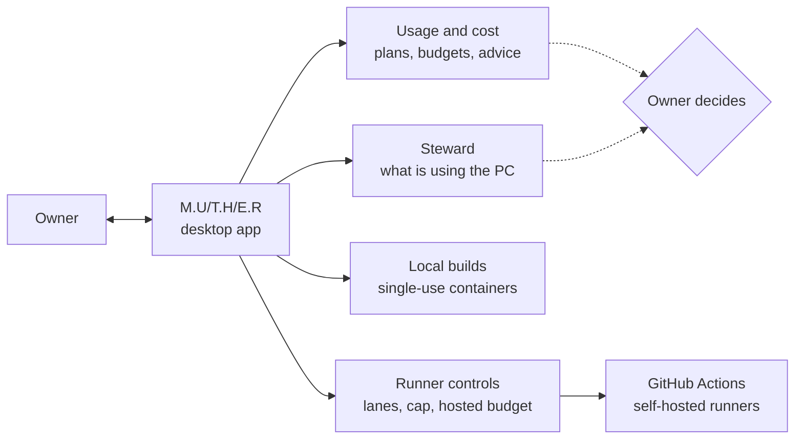
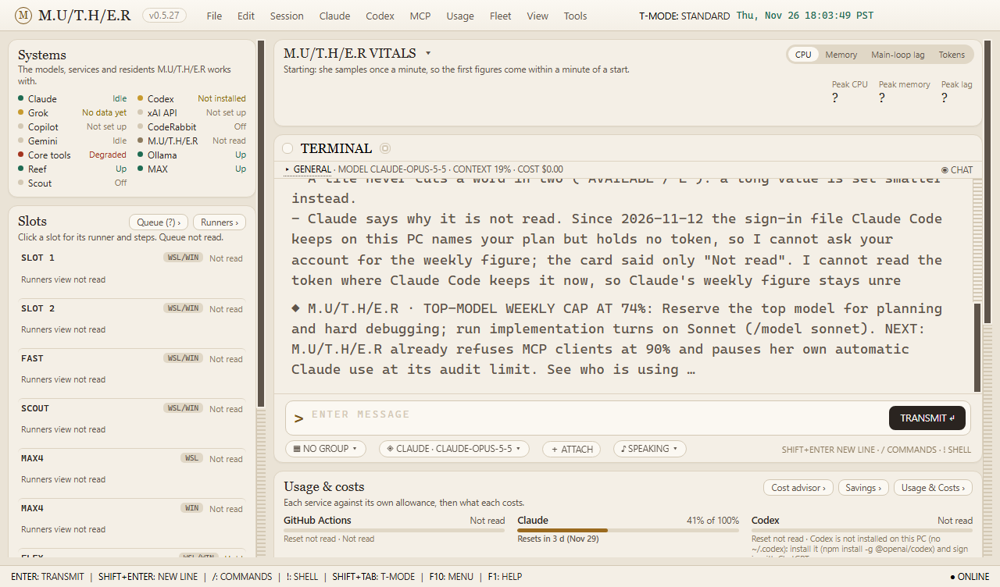
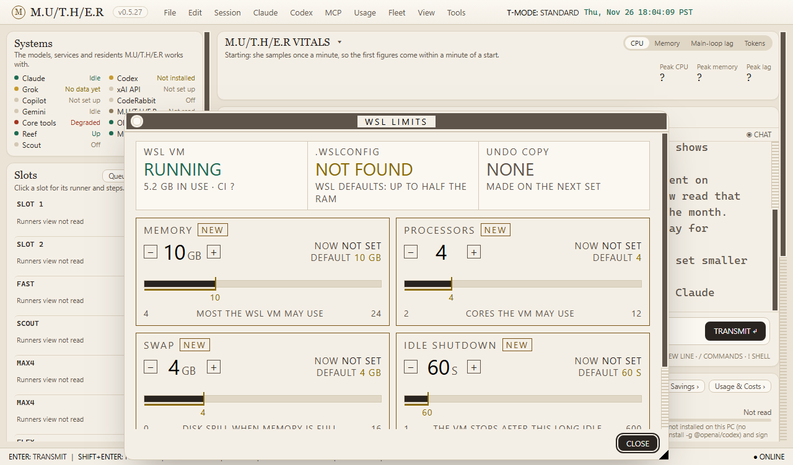
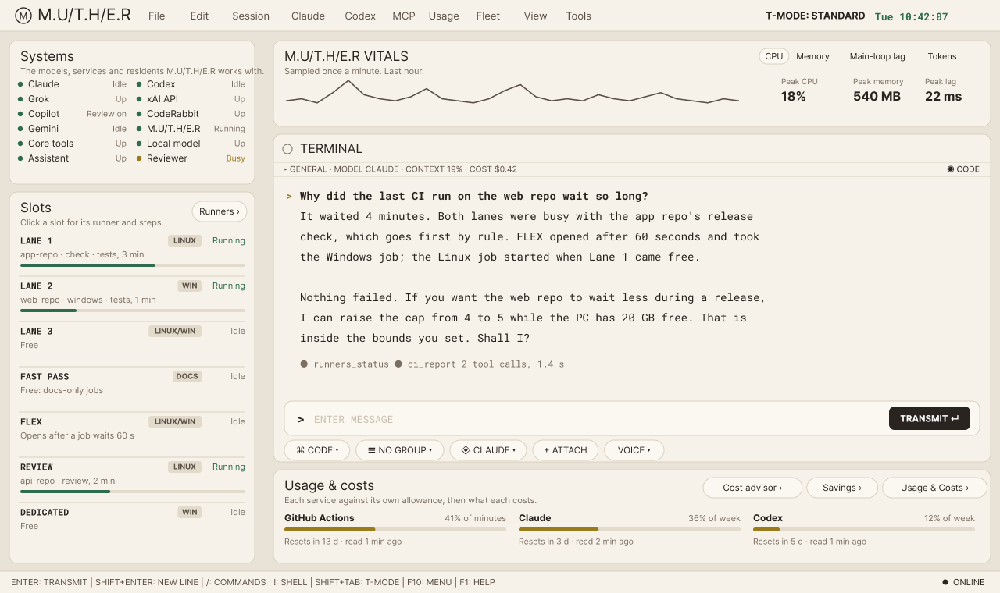
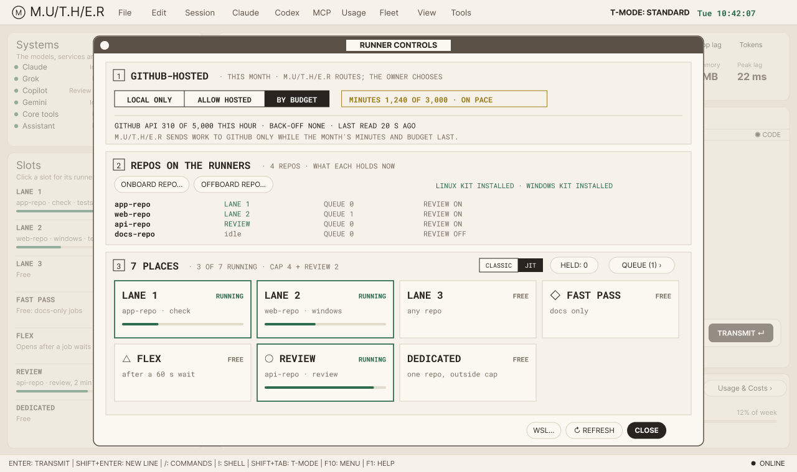
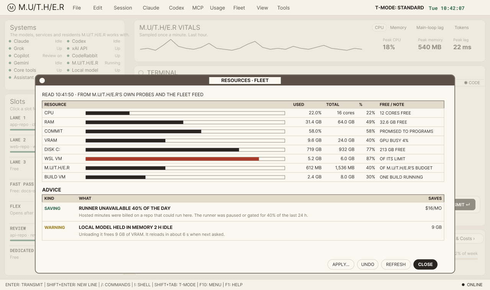
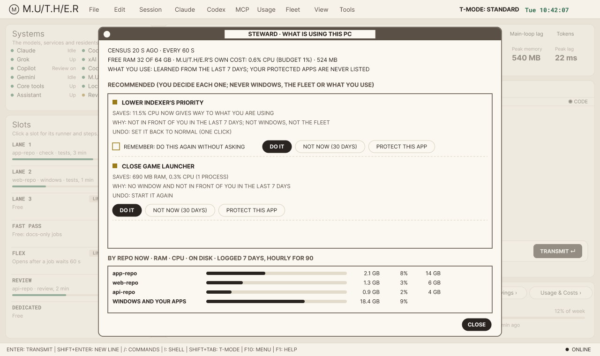

# M.U/T.H/E.R: Desktop Control Plane for Local AI Work (Showcase)

> **This is a showcase repository.** The M.U/T.H/E.R source code is private. This repo holds the overview, architecture and screens so reviewers can see what was built. Questions are welcome through [LinkedIn](https://www.linkedin.com/in/jnewell).

M.U/T.H/E.R (Model Unification / Tool Harness / Execution Runtime) is the desktop app that runs the engineering side of MAX Research Collective on one Windows PC. It tracks and cuts AI usage costs, runs CI (continuous integration) on local runners instead of paid hosted minutes, and builds installers locally. It is in daily use and in active development.

## What it does

- **Usage and cost:** shows plan limits, reset times, budgets and spend across the AI and review services in use, and advises how to make each allowance last. Anything it could not read says "not read", never zero.
- **Local CI:** coordinates the self-hosted runners on the PC within one cap, decides when hosted minutes may be used against a monthly budget, and shows every lane and what is waiting.
- **Local builds:** builds installers in capped, single-use containers on the PC.
- **Resources:** watches CPU, memory, disk and the virtual machines, and recommends changes with what each saves. The owner decides each one.
- **Spend gate:** a paid call over the monthly budget is held.

## Stack

- **Shell:** Electron and TypeScript on Windows
- **Agent engine:** the Claude Agent SDK
- **CI:** GitHub Actions on self-hosted runners (Windows and WSL)
- **Builds:** Docker

## Architecture

## Screenshots

From the running app, version 0.5.27, in a clean test machine.

**Main window**

**WSL limits**

## Screen mock-ups

Design mock-ups of the current screens, with invented repository names.

**Home**

**Runner controls**

**Resources**

**Steward**

## Read more

- [MAX Research Collective](https://www.maxresearchcollective.com)
